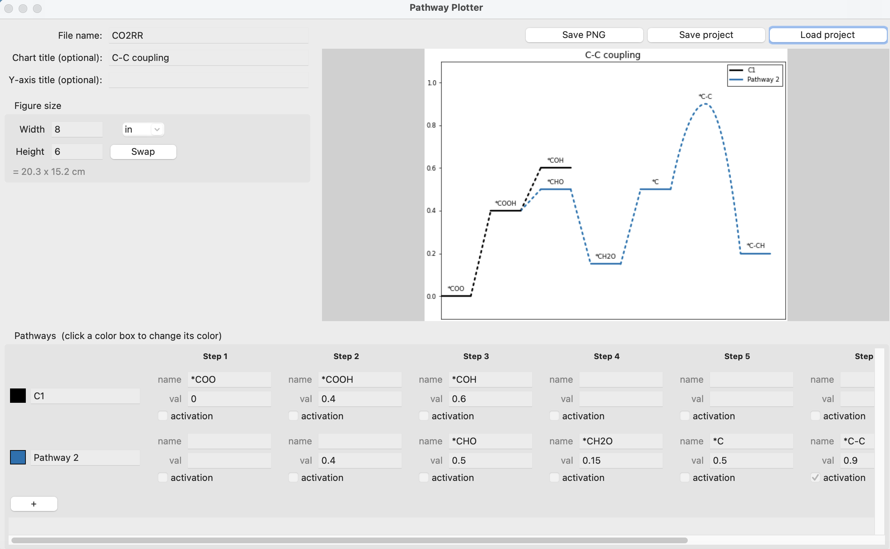

# Pathway Plotter

A small desktop tool for drawing energy-pathway style figures: horizontal
"plateaus" for each step, dashed connectors between them, dashed arches for
activation barriers, and several pathways that can branch from and merge back
into one another. Fill in a table, watch the figure update, and export it as a
PNG. Projects can be saved and reopened later.



## Features

- **Pathways as rows, steps as columns.** Step *i* of every pathway is drawn at
  the same x position, so branches line up.
- **Three values per step:** a *name* (written above the step), a *value*
  (its y position) and an *activation* checkbox.
- **Activation steps** are drawn as a dashed parabolic arch between the
  neighbouring steps instead of a plateau.
- **Blank steps are skipped.** Leave a step empty for a pathway and its
  neighbours are simply joined with a dashed line.
- **Branches share colour.** When pathways share a step (same step number and
  same value), it is drawn once, in the colour of the pathway entered first.
- **Up to 10 pathways**, with colour-blind-friendly default colours (black, blue,
  red, yellow, then six more). Click a colour box to pick any other colour.
- **Adjustable figure size** in inches or centimetres (default 8 x 6 in), with a
  button to swap width and height. The preview shows the exact proportions, and
  the PNG is saved at 300 dpi.
- **Optional chart title and y-axis title**, and a legend whenever there is more
  than one pathway.
- **Save / load projects** as plain `.json` files so you can come back and edit.

## Requirements

- Python 3.9 or newer
- `matplotlib` 3.5 or newer and `numpy`
- `tkinter` (included with the standard python.org and Anaconda installers; on
  Debian/Ubuntu install it with `sudo apt install python3-tk`)

```bash
pip install matplotlib numpy
```

## Run

```bash
python pathway_plotter.py
```

To try it right away, click **Load project** and open `example.json`.

## How to use

1. Type a **file name** (used as the suggested name when saving) and, if you
   like, a chart title and y-axis title.
2. Enter a name and a value for each step of **Pathway 1**. Tick
   **activation** for a step that should be drawn as an arch.
3. Click the **+** to the right of the last step to add a step (every pathway
   gets one), and the **+** under the pathway names to add a pathway.
4. Rename a pathway by editing its name box; click its coloured square to
   change its colour.
5. Set the **figure size** if the default does not suit.
6. **Save PNG** exports the figure. **Save project** writes a `.json` file that
   **Load project** can open again.

Tips:

- The mouse wheel scrolls the pathway table (hold Shift to scroll sideways).
- Values must be numbers; a step with an empty or non-numeric value is left out.
- Figure sides must be between 1 and 50 inches.

## Project file format

Projects are readable JSON, for example:

```json
{
  "title": "Example pathways",
  "ylabel": "Relative energy",
  "file_name": "example",
  "fig_width": "8",
  "fig_height": "6",
  "fig_unit": "in",
  "pathways": [
    {
      "name": "Pathway 1",
      "color": "#000000",
      "steps": [
        {"name": "a1", "val": "0", "act": false},
        {"name": "t1", "val": "4.5", "act": true}
      ]
    }
  ]
}
```

Files saved by earlier versions (without colours or a figure size) still load;
the defaults are used for the missing parts.

## License

Add a `LICENSE` file to say how others may use this code (for example MIT).
